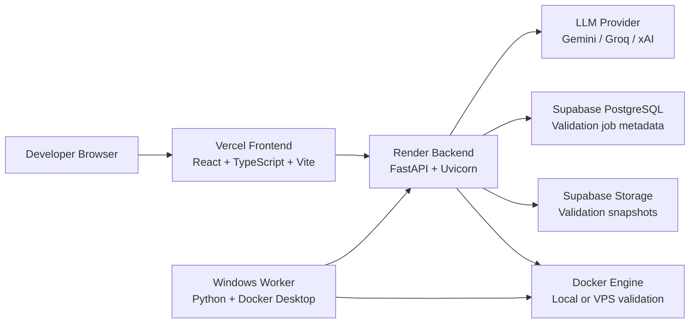

# RootPatch

RootPatch is an AI-powered automated debugging and code repair platform. It uploads a project archive, performs static analysis, generates AI root-cause explanations, proposes unified-diff patches, requires explicit human approval before application, creates backups, and validates applied patches inside isolated Docker containers.

The goal is to reduce manual debugging effort while keeping code changes reviewable, reversible, and security-bounded.

## Table of Contents

- [Key Features](#key-features)
- [Architecture](#architecture)
- [Technology Stack](#technology-stack)
- [Repository Structure](#repository-structure)
- [Local Setup](#local-setup)
- [Environment Configuration](#environment-configuration)
- [Security](#security)
- [Deployment](#deployment)
- [Remote Validation Worker](#remote-validation-worker)
- [Testing](#testing)
- [Limitations and Future Improvements](#limitations-and-future-improvements)
- [Screenshots](#screenshots)
- [License](#license)

## Key Features

### Fully tested locally

- ZIP project upload with size, file-count, and extraction limits.
- Safe extraction with symlink rejection and path confinement.
- Project inspection, language detection, dependency manifests, and structure browsing.
- Static analysis using Python AST checks, Ruff, and Bandit.
- AI root-cause analysis with pluggable LLM providers.
- Automated unified-diff patch generation.
- Patch review, approval, rejection, and controlled application.
- Immutable pre-application backups.
- SHA-256 integrity verification for applied patches.
- Patch application audit history.
- Isolated Docker container validation with baseline regression comparison.
- Validation history and report persistence.
- Frontend status-gated resource loading and project switching protection.

### Implemented and tested at unit/integration level

- Remote validation job management with Supabase PostgreSQL.
- Atomic job claiming with `FOR UPDATE SKIP LOCKED`.
- Worker authentication using a SHA-256-hashed bearer token.
- Job leases, heartbeats, expiry, and requeue handling.
- Supabase Storage snapshot upload and download.
- Windows worker with outbound HTTPS polling and restricted Docker execution.
- Frontend polling for remote validation job status.

### Implemented but not end-to-end verified

- Full remote validation workflow across Vercel, Render, Supabase, Cloudflare R2/Supabase Storage, and a local Windows worker.
- Durable storage of all project workspaces on Render Free.
- Windows worker running as an unattended service.
- Baseline regression comparison in the remote validation result path.

## Architecture



### Core workflow

```text
Upload -> Inspect -> Static Scan -> AI Analysis -> Patch Generation -> Review -> Approval -> Apply -> Docker Validation -> History
```

### Remote validation workflow

```text
Vercel Frontend -> Render Backend -> PostgreSQL job record -> R2/Supabase snapshot -> Windows worker -> Restricted Docker container -> Result submission -> Render persistence -> Frontend polling
```

Remote validation is disabled by default. Set `ROOTPATCH_REMOTE_VALIDATION_ENABLED=true` only after all infrastructure is configured and tested.

## Technology Stack

### Frontend
- React
- TypeScript
- Vite
- Tailwind CSS

### Backend
- Python
- FastAPI
- Uvicorn

### AI
- Google Gemini
- Groq
- xAI / Grok

### Database and storage
- PostgreSQL
- Supabase PostgreSQL
- Supabase Storage

### Validation
- Docker
- pytest
- Python-based Windows worker

Redis is not used in this project.

## Repository Structure

```text
Rootpatch/
├── backend/                  # FastAPI application
│   ├── app/                  # API, services, schemas, utilities
│   ├── migrations/           # PostgreSQL migrations
│   ├── tests/                # Backend test suite
│   ├── requirements.txt      # Development dependencies
│   └── requirements-prod.txt # Pinned production dependencies
├── frontend/                 # React + Vite + TypeScript dashboard
│   ├── src/                  # Application source
│   ├── public/               # Static assets, including favicon
│   └── package.json
├── worker/                   # Windows remote validation worker
├── deploy/                   # Caddy, systemd, environment template, deployment guide
├── docker/                   # Python validation image
└── README.md
```

## Local Setup

### Prerequisites

- Python 3.12
- Node.js 20 LTS
- Docker Desktop with Linux containers enabled
- Git

### Backend

```bash
cd backend
python -m venv .venv

# Windows
.venv\Scripts\activate

# macOS/Linux
source .venv/bin/activate

python -m pip install -r requirements.txt
cp .env.example .env
```

Edit `backend/.env` with your provider and limits. Then start the backend:

```bash
python -m uvicorn main:app --reload --port 8000
```

Interactive API docs are available at:

```text
http://localhost:8000/docs
```

Health check:

```text
http://localhost:8000/api/health
```

### Frontend

```bash
cd frontend
npm install
cp .env.example .env   # optional: defaults to http://localhost:8000
npm run dev
```

Frontend dev server runs at:

```text
http://localhost:5173
```

### Docker validation image

```bash
docker build -t rootpatch-python-validate:latest -f docker/Dockerfile.python-validate .

docker run --rm \
  --network none \
  --read-only \
  --tmpfs /tmp:rw,noexec,nosuid,size=64m \
  --user 65534:65534 \
  rootpatch-python-validate:latest pytest --version
```

Expected output:

```text
pytest 8.3.4
```

### Environment configuration

Backend variables are documented in `backend/.env.example`. Production values belong in `/etc/rootpatch/rootpatch.env` on the target server, never in committed files.

Important variables include:

| Variable | Purpose |
|---|---|
| `ROOTPATCH_WORKSPACE_DIR` | Workspace root for uploaded projects |
| `ROOTPATCH_MAX_UPLOAD_BYTES` | Maximum ZIP upload size |
| `ROOTPATCH_LLM_PROVIDER` | `gemini`, `openai`, `xai`, or `grok` |
| `ROOTPATCH_LLM_MODEL` | Provider model name |
| `ROOTPATCH_LLM_API_KEY` | LLM API key |
| `ROOTPATCH_LLM_BASE_URL` | Optional provider base URL |
| `ROOTPATCH_CORS_ORIGINS` | Comma-separated allowed origins |
| `ROOTPATCH_VALIDATION_PYTHON_IMAGE` | Python validation image |
| `ROOTPATCH_VALIDATION_NODE_IMAGE` | Node validation image |
| `ROOTPATCH_VALIDATION_NETWORK_DISABLED` | Disable container network access |
| `ROOTPATCH_REMOTE_VALIDATION_ENABLED` | Enable remote worker mode |
| `ROOTPATCH_DATABASE_URL` | Supabase PostgreSQL connection string |
| `SUPABASE_URL` | Supabase project URL |
| `SUPABASE_SERVICE_ROLE_KEY` | Supabase service-role key |
| `ROOTPATCH_OBJECT_STORAGE_BUCKET` | Supabase Storage bucket name |
| `ROOTPATCH_WORKER_TOKEN_HASH` | SHA-256 hash of worker token |

Frontend production variable:

| Variable | Purpose |
|---|---|
| `VITE_API_BASE_URL` | Backend origin for separate frontend/backend deployments |

For local development, `VITE_API_BASE_URL` may be unset; the frontend falls back to `http://localhost:8000`.

## Security

RootPatch applies multiple security controls:

- ZIP path traversal protection.
- Extraction limits for file count, total size, and individual file size.
- Workspace path confinement with `is_within_directory` checks.
- Uploaded code is never executed directly on the host.
- Patch validation runs only inside Docker containers.
- Docker containers use `--network none`, `--cap-drop ALL`, `--security-opt no-new-privileges:true`, `--read-only`, a tmpfs `/tmp`, and CPU, memory, and PID limits.
- Containers run as non-root user `65534:65534`.
- Patch approval is explicit and separate from application.
- Patch application is atomic and creates immutable backups.
- SHA-256 integrity checks protect applied files.
- Worker authentication uses a SHA-256-hashed bearer token with constant-time comparison.
- CORS origins are loaded from environment configuration.
- Secrets are never committed; `.env` files are ignored.

Docker container restrictions are defense-in-depth. They reduce the attack surface of validated project code but do not provide complete host isolation. Access to the Docker daemon is effectively root-equivalent on the host.

## Deployment

### Frontend (Vercel)

- Root directory: `frontend`
- Build command: `npm run build`
- Output directory: `dist`
- Environment variable: `VITE_API_BASE_URL=https://rootpatch.onrender.com`

### Backend (Render)

- Root directory: `backend`
- Build command: `pip install --no-cache-dir -r requirements-prod.txt`
- Start command: `uvicorn main:app --host 0.0.0.0 --port $PORT --workers 1`
- Python version: `3.12` via `backend/.python-version`
- Health endpoint: `https://rootpatch.onrender.com/api/health`

### Supabase PostgreSQL

- Apply `backend/migrations/001_create_validation_jobs.sql` using the Supabase SQL Editor.
- Configure `ROOTPATCH_DATABASE_URL` in Render.
- Use `sslmode=require`.
- The transaction pooler is recommended for Render.

### Supabase Storage

- Create a private bucket named `rootpatch-validation`.
- Configure `SUPABASE_URL`, `SUPABASE_SERVICE_ROLE_KEY`, and `ROOTPATCH_OBJECT_STORAGE_BUCKET`.
- The service-role key must remain backend-only.

### Optional Windows remote validation worker

1. Install Python 3.12 and Docker Desktop in Linux container mode.
2. Build or pull `rootpatch-python-validate:latest`.
3. Configure `worker/.env`.
4. Run:

```bash
python main.py
```

The worker polls Render over outbound HTTPS and executes validation inside restricted Docker containers.

### Free-hosting limitations

- Render Free has an ephemeral filesystem.
- Project uploads and validation reports are not durable on Render unless stored externally.
- Supabase and Supabase Storage are required for durable remote validation data.
- Render Free may sleep, delaying worker job processing.
- Remote validation is disabled by default.

## Remote Validation Worker

The remote worker architecture is implemented but not end-to-end verified.

Components:

- Backend creates immutable patched and baseline snapshots.
- Snapshots are uploaded to Supabase Storage.
- Job metadata is stored in Supabase PostgreSQL.
- The Windows worker claims jobs atomically.
- The worker verifies SHA-256 checksums.
- The worker runs tests inside restricted Docker containers.
- The worker submits bounded results back to Render.
- The frontend polls job status and displays the final report.

Do not claim remote validation is production-ready until a complete end-to-end test has passed.

## Testing

### Backend

```bash
cd backend
python -m pytest
```

Latest verified result:

- `192 passed, 4 skipped, 1 warning`

### Frontend

```bash
cd frontend
npm test
npm run typecheck
npm run build
```

Latest verified result:

- `31 passed`
- TypeScript typecheck: passed
- Production build: passed

### Worker

```bash
cd worker
python -m py_compile config.py client.py runner.py main.py
```

Verified checks:

- Syntax compilation passed
- Safe ZIP extraction passed
- Path traversal rejection passed
- Restricted Docker command construction passed

### Docker

```bash
docker build -t rootpatch-python-validate:latest -f docker/Dockerfile.python-validate .
```

Verified:

- Image build passed
- Image runs `pytest 8.3.4` under network isolation, read-only root filesystem, tmpfs, and non-root execution

### Remote validation E2E status

Not verified. Requires configured Supabase, Supabase Storage, Render, and a running Windows worker.

## Limitations and Future Improvements

- Remote Docker validation is implemented but not end-to-end verified.
- Durable storage of all project workspaces is incomplete on Render Free.
- Baseline regression comparison is not included in the remote result path.
- Windows worker is not installed as a service.
- Rate limiting and monitoring are not implemented.
- No automated backup scheduling is configured.
- Render Free service sleep may delay validation jobs.

## Screenshots

No screenshots are currently committed. Add images under `docs/screenshots/` and reference them here when available.

Suggested filenames:

- `docs/screenshots/dashboard.png`
- `docs/screenshots/upload.png`
- `docs/screenshots/findings.png`
- `docs/screenshots/patch-review.png`
- `docs/screenshots/validation.png`
- `docs/screenshots/history.png`

## License

No license file is currently included in this repository. Add a `LICENSE` file before public distribution.